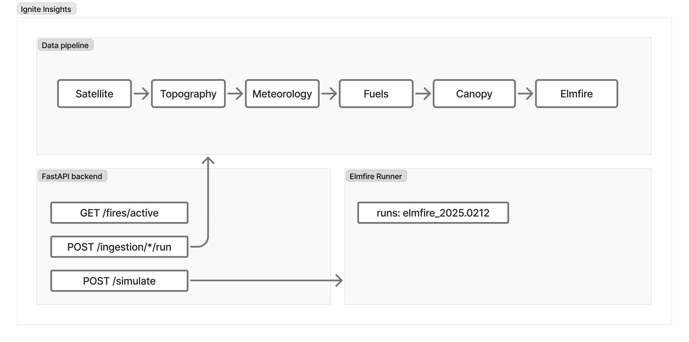

# IgniteInsights API

Forest fire prediction system for Patagonia — ELMFIRE + VIIRS + GFS + Copernicus DEM pipeline.

**Authors:** Ignacio Chevallier Boutell & Manuel Salas Seeber  
**Universidad:** Universidad Austral — Tesis 2026

## Architecture



See [docs/architecture.md](docs/architecture.md) for details.

## Requirements

- Docker Desktop
- Python 3.12+
- [uv](https://docs.astral.sh/uv/)
- GDAL (for rasterio — see [docs/local-development.md](docs/local-development.md))
- API keys: FIRMS MAP_KEY, OpenTopography API Key

## Quickstart

```bash
cp .env.example .env
# Fill in FIRMS_MAP_KEY and OPENTOPOGRAPHY_API_KEY in .env

docker compose up
# API → http://localhost:8000
# Docs → http://localhost:8000/docs

# First-time setup: run migrations
docker compose exec api uv run alembic upgrade head
```

## Endpoints (Sprint actual — Hito 3)

| Method | Path | Description |
|--------|------|-------------|
| `GET` | `/health` | Healthcheck + DB status |
| `GET` | `/api/v1/fires/active` | Active fire detections (GeoJSON) |
| `POST` | `/api/v1/ingestion/firms/run` | Trigger FIRMS VIIRS ingestion |
| `POST` | `/api/v1/ingestion/dem/run` | Trigger Copernicus DEM download |
| `GET` | `/api/v1/ingestion/runs/{id}` | Ingestion run status |

## Documentation

- [Architecture](docs/architecture.md)
- [Data Sources](docs/data-sources.md)
- [ELMFIRE Mapping](docs/elmfire-mapping.md)
- [Local Development](docs/local-development.md)
