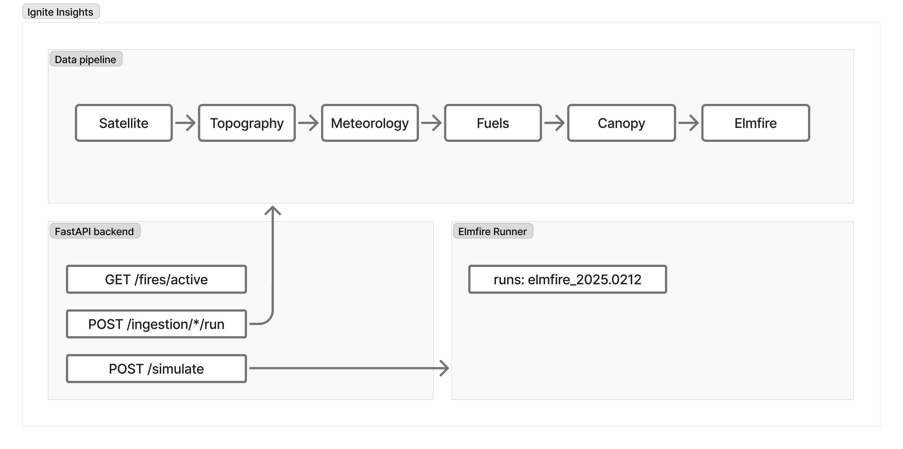

# Arquitectura



## Objetivo del sistema

IgniteInsights es un flujo de predicción de incendios forestales para el Parque Nacional Los Alerces. Integra detecciones satelitales, meteorología, topografía y combustibles para preparar simulaciones con ELMFIRE. Los resultados se publican como isócronas GeoJSON y se muestran en un panel web.

## Flujo de datos

```
1. Ingesta       ingestion/             → descarga fuentes al sistema de archivos y la base
                 satellite/firms        → FireDetection (PostGIS Point)
                 topography/opentopo    → dem_cop30_raw.tif → data/static/opentopography/{date}/
                 meteorology/gfs        → gfs_{var}.tif     → data/raw/gfs/{date}/
                 fuels/worldcover       → worldcover_raw.tif → data/static/worldcover/{date}/

2. Preparación   preparation/           → deriva rásteres ELMFIRE con los datos más recientes
                                        → data/elmfire/inputs/{prep_id}/
                 raster_aligner         → dem.tif, slp.tif, asp.tif (EPSG:32719, 30 m)
                 fuels_builder          → fbfm40.tif (tabla WorldCover → Scott & Burgan)
                 weather_builder        → ws.tif, wd.tif, m1.tif, m10.tif, m100.tif
                 ignition_builder       → phi.tif (SDF desde FireDetections)
                 namelist_writer        → elmfire.data

3. Simulación    elmfire/runner/        → HTTP POST al microservicio elmfire-runner
                                        → data/elmfire/outputs/{sim_id}/

4. Visualización postprocessing/        → GeoJSON isócronas servidas por la API
```

La **ingesta y la preparación ocurren en la misma ruta** (`POST /ingestion/run`): al terminar las descargas, el servicio de preparación deriva los insumos ELMFIRE con los datos más recientes de la base.

## Separación arquitectural central

```
┌─────────────────────────────────────────────────────┐
│  igniteinsights-api  (este repositorio)             │
│                                                     │
│  1. Flujo de datos                                  │
│     ingestion/ → preparation/ → elmfire/builder/    │
│                                                     │
│  2. Servidor FastAPI                                │
│     Expone rutas de focos, predicciones,            │
│     ingestas y resultados a la interfaz             │
│                                                     │
│  3. Interfaz Next.js                                │
│     Panel de visualización en frontend/             │
└─────────────────────┬───────────────────────────────┘
                      │ HTTP POST /simulate
                      ▼
┌───────────────────────────────────────────────────────┐
│  elmfire-runner  (microservicio separado)             │
│                                                       │
│  Recibe: elmfire_data_path + inputs_dir + outputs_dir │
│  Ejecuta: elmfire_2025.0212 < elmfire.data            │
│  Devuelve: rutas a salidas (isócronas, TOA, etc.)     │
└───────────────────────────────────────────────────────┘
```

Ambos servicios comparten un volumen Docker en `/app/data/elmfire/`. El microservicio ELMFIRE es un ejecutable Linux compilado desde la rama `2025.0212` de `lautenberger/elmfire` y no forma parte de este repositorio; el cliente HTTP que lo consume sí.

## Estructura del repositorio

```
igniteinsights/
│
├── app/
│   ├── main.py                   # FastAPI app, routers, lifespan
│   ├── config.py                 # Pydantic Settings desde env vars
│   ├── dependencies.py           # Dependencias comunes (DB session, etc.)
│   │
│   ├── api/v1/
│   │   ├── router.py             # Agrega todos los sub-routers
│   │   ├── fires.py              # GET /fires/active
│   │   ├── ingestion.py          # POST /ingestion/{source}/run, POST /ingestion/run
│   │   ├── dashboard.py          # GET /dashboard/summary
│   │   └── simulations.py        # POST /simulations/run, GET /simulations/{id}
│   │
│   ├── ingestion/
│   │   ├── satellite/firms/      # NASA FIRMS VIIRS NOAA-20 NRT ✅
│   │   ├── topography/           # Copernicus GLO-30 DEM ✅
│   │   │   └── opentopography/
│   │   ├── meteorology/gfs/      # NOAA GFS 0.25° vía Herbie ✅
│   │   ├── fuels/worldcover/     # ESA WorldCover 10 m ✅
│   │   └── canopy/               # Hansen GFC (cc) + ETH Height (ch) ✅
│   │       ├── client.py
│   │       ├── service.py
│   │       ├── schemas.py
│   │       └── errors.py
│   │
│   ├── preparation/
│   │   └── service.py            # Orquesta builders → elmfire/inputs/{prep_id}/ ✅
│   │
│   ├── elmfire/
│   │   ├── builder/
│   │   │   ├── raster_aligner.py  # Reproyecta DEM → dem/slp/asp (EPSG:32719, 30 m) ✅
│   │   │   ├── weather_builder.py # GFS u10/v10/t2m/rh → ws/wd/m1/m10/m100 ✅
│   │   │   ├── fuels_builder.py   # WorldCover → fbfm40 (tabla Scott & Burgan) ✅
│   │   │   ├── ignition_builder.py# FIRMS points → phi.tif (SDF) ✅
│   │   │   ├── canopy_builder.py  # Hansen/ETH → cc/ch → cbh/cbd ✅
│   │   │   └── namelist_writer.py # Genera elmfire.data ✅
│   │   └── runner/                # Cliente HTTP al microservicio elmfire-runner ✅
│   │
│   ├── postprocessing/           # Shapefile → GeoJSON
│   ├── domain/                   # SQLAlchemy ORM + Pydantic schemas de respuesta
│   └── db/                       # Engine AsyncPG, session factory, repository CRUD
│
├── frontend/                     # Panel Next.js (puerto 3000)
├── alembic/                      # Migraciones de base de datos
├── data/                         # Datos de ejecución (ignorados salvo .gitkeep)
│   ├── raw/                      # Datos dinámicos (se actualizan con cada run)
│   │   ├── firms/{YYYY-MM-DD}/viirs_noaa20_nrt.csv
│   │   └── gfs/{YYYY-MM-DD}/{cycle}_{var}.tif
│   ├── static/                   # Datos estáticos (descargados una vez, actualizables)
│   │   ├── opentopography/{YYYY-MM-DD}/dem_cop30_raw.tif
│   │   ├── worldcover/{YYYY-MM-DD}/esa_worldcover_v200_10m.tif
│   │   ├── dem.tif               # ← derivado del DEM raw (caché, EPSG:32719 30 m)
│   │   ├── slp.tif               # ← slope derivado
│   │   ├── asp.tif               # ← aspect derivado
│   │   └── fbfm40.tif            # ← WorldCover → Scott & Burgan (caché)
│   └── elmfire/
│       ├── inputs/{prep_id}/     # Generado por preparation/service.py
│       │   ├── dem.tif, slp.tif, asp.tif, fbfm40.tif
│       │   ├── ws.tif, wd.tif, m1.tif, m10.tif, m100.tif
│       │   ├── phi.tif           # ignición desde FIRMS
│       │   └── elmfire.data      # namelist Fortran
│       └── outputs/{sim_id}/
│           ├── fire_size_stats.csv    # siempre generado por ELMFIRE
│           ├── time_of_arrival_*.tif  # NO "toa_*.tif" — nombre real de ELMFIRE
│           ├── flin_*.tif
│           ├── vs_*.tif               # spread rate (DUMP_SPREAD_RATE)
│           └── hourly_isochrones.shp  # post-procesado con gdal_contour, no es
│                                      # un flag nativo de ELMFIRE (ver elmfire-runner/app/runner.py)
└── docs/
```

## Estrategia de datos: originales y estáticos

| Carpeta | Contenido | Frecuencia de actualización |
|---|---|---|
| `data/raw/` | FIRMS CSV, GFS GeoTIFFs | Cada ingesta (dinámico) |
| `data/static/opentopography/` | dem_cop30_raw.tif | Solo cuando `include_dem=true` |
| `data/static/worldcover/` | esa_worldcover_v200_10m.tif | Solo cuando `include_worldcover=true` |
| `data/static/canopy/` | hansen_treecover2000.tif, eth_canopy_height.tif | Solo cuando `include_canopy=true` |
| `data/static/` (raíz) | dem/slp/asp/fbfm40 derivados | Calculados una vez, almacenados |
| `data/elmfire/inputs/` | Todos los insumos ELMFIRE | Una carpeta por preparación |
| `data/elmfire/outputs/` | Salidas del simulador | Una carpeta por simulación |

Los datos estáticos (DEM, WorldCover) se excluyen por defecto del `POST /ingestion/run` (`include_dem: false`, `include_worldcover: false`) porque no cambian entre ejecuciones. Para regenerarlos, pasarlos explícitamente como `true`.

## Patrón de modularización por fuente de datos

Cada fuente de datos sigue el mismo patrón de cuatro capas:

```
client.py
  └── Solo llamadas HTTP/IO externas. Sin lógica de negocio.
      Maneja tiempos de espera y errores HTTP. Devuelve datos originales.

schemas.py
  └── Tipado Pydantic de entrada/salida.
      Modelos del proveedor externo y modelos internos del dominio.

normalizer.py  (donde aplique)
  └── Transforma datos del proveedor al modelo interno.
      Correspondencia de campos, conversión de unidades y filtros de calidad.

service.py
  └── Orquesta el flujo completo: cliente → normalizador → repositorio → archivos.
      Único punto de entrada desde las rutas FastAPI.
      Registra `IngestionRun` con estado final.

errors.py
  └── Excepciones específicas del proveedor.
      Permite que la ruta maneje errores de forma granular.
```

**Principio clave:** FastAPI nunca llama directamente a `client.py`. Solo llama a `service.py`. Esto permite reemplazar cualquier proveedor externo modificando únicamente `client.py` (y `normalizer.py` si existe) sin tocar la API ni el resto del sistema.

## Estrategia de CRS

| Capa                     | CRS                       | Motivo                                              |
| ------------------------ | ------------------------- | --------------------------------------------------- |
| Ingesta y almacenamiento | EPSG:4326 (WGS84)         | Geometrías PostGIS, respuestas API, fuentes nativas |
| Procesamiento ELMFIRE    | EPSG:32719 (UTM Zone 19S) | ELMFIRE requiere proyección métrica                 |
| Resolución               | 30 m                      | Resolución nativa del DEM Copernicus GLO-30         |

Todos los rásteres de entrada a ELMFIRE comparten CRS, resolución y extensión exactos. `elmfire/builder/raster_aligner.py` garantiza este alineamiento mediante reproyección bilineal.

## Principios aplicados en todo el proyecto

- **Tipos obligatorios:** todo `def` y `async def` declara tipos de entrada y retorno.
- **Modelos Pydantic v2:** validación en todas las capas que reciben datos externos.
- **Registro estructurado:** usar `logging` con formato JSON en producción. Nunca `print()`.
- **Sin credenciales en código:** siempre desde `settings.variable`. Un valor fijo es un defecto.
- **Errores explícitos:** cada módulo tiene su propio `errors.py`; las rutas devuelven respuestas HTTP apropiadas.
- **Separación de capas:** FastAPI → `service.py` → `client.py` + `repository.py`. Nunca saltar capas.
- **uv** sobre Poetry: resolución más rápida, sin dependencias externas, PEP 517.
- **asyncpg + SQLAlchemy async**: acceso no bloqueante a la DB para FastAPI.
- **GeoAlchemy2:** columnas de geometría PostGIS tipadas en Python.
- **`asyncio.to_thread` en la ingesta:** las descargas síncronas se ejecutan en un conjunto de hilos para no bloquear el bucle de eventos.
- **Ingesta idempotente**: re-ejecutar la misma ingesta no crea duplicados. Para datos estáticos (DEM, WorldCover) se verifica el `RasterAsset` existente antes de descargar.
- **Preparación automática:** cada `POST /ingestion/run` deriva los insumos ELMFIRE con los datos más recientes disponibles.
